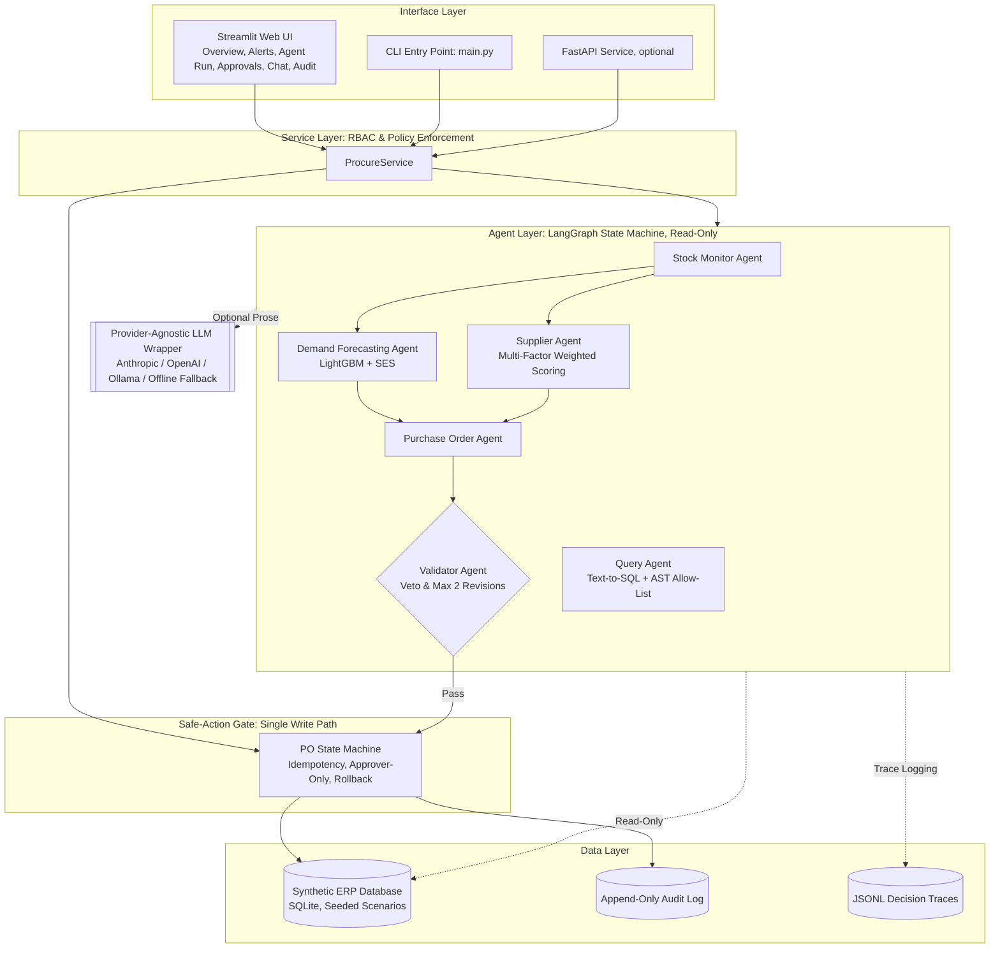

<div align="center">

# ProcureAgents

### Innodata AI Catalyst '26 · University Track

**Team Ralypto · University of Kelaniya**
Arkeshkar · Seenujan · Harishchandran · Braynkanth

*A safe, auditable multi-agent AI system for autonomous inventory forecasting, supplier negotiation, and human-governed procurement in ERP*

[Overview](#overview) · [Architecture](#architecture) · [User Interface](#user-interface) · [Setup](#setup) · [Commands](#commands) · [Benchmark](#reproducing-the-benchmark) · [Documentation](#documentation)

[](https://python.org)
[](https://langchain-ai.github.io/langgraph/)
[](https://lightgbm.readthedocs.io)
[](project/tests)
[](pyproject.toml)
[](pyproject.toml)

</div>

---

## Overview

Small and mid-size enterprises often decide what to reorder, how much, and from which vendor by hand or using crude spreadsheets. The consequence is frequent stockouts, overstock depreciation, and expired goods.

**ProcureAgents** is a collaborative team of specialised AI agents that autonomously takes an operational trigger (such as low inventory or batch expiration) to an approved, policy-checked purchase order in the ERP:

* **Agents Propose (Zero-Hallucination Math & ML):** Stock Monitor detects shortfalls; Demand Forecasting (LightGBM regression + Exponential Smoothing) and Supplier Evaluation (multi-criteria decision scoring) run concurrently on a compiled LangGraph state graph.
* **Independent Validator Checks:** A separate Validator Agent verifies budget caps, minimum order quantities (MOQ), supplier pricing contracts, and shelf-life constraints, holding absolute veto authority. The PO agent may revise up to twice before escalating to human oversight.
* **Human-in-the-Loop Safe Action Gate:** AI agents are strictly read-only and **never spend company money autonomously**. The Safe-Action Gate enforces role-based access control (RBAC), prevents self-approval by buyers, manages a purchase order state machine with idempotency keys, and writes an append-only, cryptographic audit trail.
* **Conversational Read-Only Intelligence ("Ask the Data"):** Staff can query ERP inventory, sales trends, and vendor metrics in plain English. Queries are converted to read-only SQL validated by an AST allow-list parser (`sqlglot`), blocking prompt injection and write intents.
* **Empirical Scientific Evaluation:** Compare the multi-agent system (System A) against a single-agent LLM baseline (System B), human purchasers (System C), and rule-based floor (System D) across identical seeded 90-day scenarios.

> [!NOTE]
> **Works 100% Offline Out-of-the-Box:** No API keys or external subscriptions are required. By default, ProcureAgents runs deterministically on local CPU using LightGBM, statistical time-series models, and local SQLite databases with zero token costs and zero latency jitter.

---

## Architecture



Detailed architectural diagrams, state machine transitions, and safety models are documented in [docs/Workflow.md](docs/Workflow.md).

---

## User Interface

The application features a modern SaaS interface built with Streamlit, organized into an intuitive 3-tier navigation structure:

1. **⭐ Start Here**:
   * **Live Demo**: A 10-second end-to-end purchasing lifecycle running live: Alert → Parallel Forecasting & Supplier Ranking → Draft PO → Policy Validator → Self-Approval Block Verification → Manager Sign-off → Audit Log & PDF export.
   * **Overview**: Executive dashboard tracking items at reorder points, immediate stockout risks, expiring batch costs, pending POs, and an interactive **"Priority Restock Needed"** action list with 1-click **"Order with AI"** triggers.
2. **📦 Purchasing Operations**:
   * **Alerts and Cases**: Clean tabular view of active inventory alerts with priority indicators, stock cover calculations, and a launch box.
   * **Agent Run**: Real-time visual timeline showing each agent node's inputs, outputs, confidence score, and latency.
   * **Approval Dashboard**: Executive purchase authorization slips displaying total values, vendor terms, forecast rationale, validator status, and 1-click **Approve**, **Reject**, or **Edit Quantity** actions.
3. **🛡️ Governance & Intelligence**:
   * **Ask the Data**: Conversational query assistant with pre-built sample categories (Stock, Suppliers, Guardrail Stress Tests).
   * **Audit Log**: Immutable audit trail proving database triggers reject unauthorized UPDATE and DELETE queries.
   * **Benchmark Results**: Interactive charts comparing System A vs B vs C vs D with 95% bootstrap confidence intervals.
   * **Settings and Registry**: Adjust supplier preference weights (Price vs Speed vs Reliability), business profiles (Supermarket, Pharmacy, Hardware), and synthetic data seeds.

---

## Setup

Requires **Python 3.9 to 3.12** and Git. No GPU and no paid API keys required.

### Windows (PowerShell)

```powershell
git clone https://github.com/Arkeshak/ralypto-university.git
cd ralypto-university
python -m venv .venv
.\.venv\Scripts\Activate.ps1
pip install -r project/requirements.txt
python project/main.py serve
```

### Linux / macOS

```bash
git clone https://github.com/Arkeshak/ralypto-university.git
cd ralypto-university
python3 -m venv .venv
source .venv/bin/activate
pip install -r project/requirements.txt
python project/main.py serve
```

The UI will automatically launch in your browser at **`http://localhost:8501`**.

> [!TIP]
> **Optional Live LLM Integration:** If you wish to enable OpenAI, Anthropic, or local Ollama models for natural language generation, copy `.env.example` to `.env` and configure your API credentials. Without `.env`, ProcureAgents automatically runs in fast, reproducible offline mode.

---

## Commands

All operational commands can be executed via `python project/main.py <command>`:

| Command | Description |
|---|---|
| `python project/main.py serve` | Starts the Streamlit web interface |
| `python project/main.py simulate [--profile pharmacy] [--approve-first]` | Seeds a synthetic ERP scenario and runs agents on all active alerts |
| `python project/main.py simulate --replay --system multi_agent` | Executes a 90-day rolling replay and reports business outcomes |
| `python project/main.py benchmark --profile supermarket --repeats 3 --seed 1` | Runs the full evaluation benchmark across all 4 systems |
| `python project/main.py study --volunteer <name>` | Interactive human purchasing study interface (System C) |
| `python project/main.py query "Which items expire within 7 days?"` | Executes a natural-language query via the Query Agent |
| `python project/main.py approve <po_id> --user bob [--reject]` | Approves or rejects a pending purchase order (RBAC enforced) |
| `python -m pytest project/tests -q` | Runs the complete unit and integration test suite (80 passed) |
| `pyrefly check project/app.py project/main.py` | Runs the Pyrefly static type checker (0 errors) |
| `ruff check project/` | Runs the Ruff linter and code quality checks (0 errors) |

### Built-in Role Accounts

* **`alice` (Buyer)**: Initiates purchasing cases, runs AI agents, drafts POs. Self-approval is strictly prevented by the Safe-Action Gate.
* **`bob` (Approver / Manager)**: Reviews pending purchase orders, edits quantities with audit reasons, and executes final approval/rejection.
* **`carol` (Viewer)**: Read-only access to dashboards, reports, and data querying.
* **`root` (Admin)**: Full administrative access, supplier weight tuning, and ERP dataset regeneration.

---

## Reproducing the Benchmark

To replicate the empirical evaluation benchmark comparing all systems on identical scenarios:

```bash
python project/main.py benchmark --profile supermarket --repeats 3 --seed 1
```

* **Evaluated Systems**:
  * **System A (Multi-Agent)**: ProcureAgents pipeline with LangGraph, LightGBM, and validator gate.
  * **System B (Single-Agent)**: Single LLM prompt with tool-calling loop and identical revision budget.
  * **System C (Human Study)**: Actual purchasing decisions recorded from human volunteers.
  * **System D (Rule-Based Floor)**: Classical static reorder-point (s, S) baseline.
* **Output Artifacts**: Stored in `results/<run_id>/` containing `summary.json`, `runs.csv`, `cases.csv`, `queries.csv`, `report.md`, and comparative Altair/Matplotlib charts.

---

## Repository Structure

```text
ralypto-university/
├── project/
│   ├── main.py                 # CLI entry point (serve, simulate, benchmark, study, query, approve)
│   ├── app.py                  # Streamlit application entry point
│   ├── requirements.txt        # Pinned dependencies
│   ├── ui/                     # Presentation layer
│   │   ├── theme.py            # Design tokens, CSS stylesheet, and component helpers
│   │   ├── pages_ops.py        # Overview, Alerts & cases, and Agent run view
│   │   ├── pages_gov.py        # Approval dashboard, Ask the data, and Audit log
│   │   ├── pages_eval.py       # Benchmark results and Settings & registry
│   │   └── state.py            # Global UI session state and service bindings
│   ├── procure/                # Core business and agent logic
│   │   ├── agents.py           # Stock monitor, supplier ranking, PO generator, validator
│   │   ├── orchestrator.py     # LangGraph state machine compilation and conditional edges
│   │   ├── forecasting.py      # LightGBM regression, Exponential Smoothing, backtesting
│   │   ├── gate.py             # Safe-action gate, PO state machine, append-only SQLite audit
│   │   ├── service.py          # Service facade enforcing RBAC and permission checks
│   │   ├── query.py            # Natural language Query Agent (AST SQL validation via sqlglot)
│   │   ├── data.py             # Synthetic ERP generator with realistic retail profiles
│   │   ├── benchmark.py        # 4-system benchmark evaluation harness
│   │   ├── simulator.py        # 90-day rolling business replay simulator
│   │   ├── report.py           # Evaluation report and statistical summary generator
│   │   ├── registry.py         # Extensible plugin and agent tool registry
│   │   └── llm.py              # Provider-agnostic LLM interface with offline fallback
│   └── tests/                  # Pytest test suite (80 unit & integration tests)
├── docs/                       # Project documentation
│   ├── Proposal.docx           # Initial project proposal
│   ├── Workflow.md             # Detailed agent workflow, state machine, and safety model
│   ├── PROJECT_DETAILS.md      # Comprehensive technical reference and benchmark results
│   └── EXTENDING.md            # Guide for adding new custom agents and tools
├── samples/                    # Sample traces, ERP database snapshots, and benchmark runs
├── pyproject.toml              # Ruff, Pytest, and Pyrefly configuration
├── pyrightconfig.json          # Pyright language server configuration
└── README.md                   # Project documentation and quickstart guide
```

---

## Documentation

| Document | Key Information |
|---|---|
| [docs/Workflow.md](docs/Workflow.md) | Agent graph topology, PO lifecycle states, conflict resolution rules, and safety gate specification |
| [docs/PROJECT_DETAILS.md](docs/PROJECT_DETAILS.md) | Technical architecture, empirical benchmark data, model descriptions, and limitations |
| [docs/EXTENDING.md](docs/EXTENDING.md) | Step-by-step tutorial on registering new agents and tools without modifying core code |
| [docs/Proposal.docx](docs/Proposal.docx) | Phase 1 problem formulation, objectives, and evaluation design |

---

## Team

**Team Ralypto · University of Kelaniya**
* Arkeshkar
* Seenujan
* Harishchandran
* Braynkanth

*Innodata AI Catalyst '26 · University Track*

