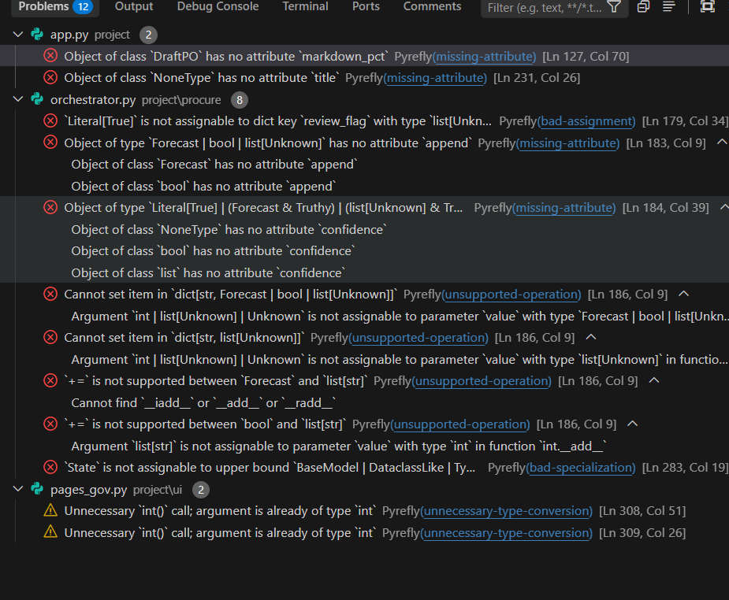
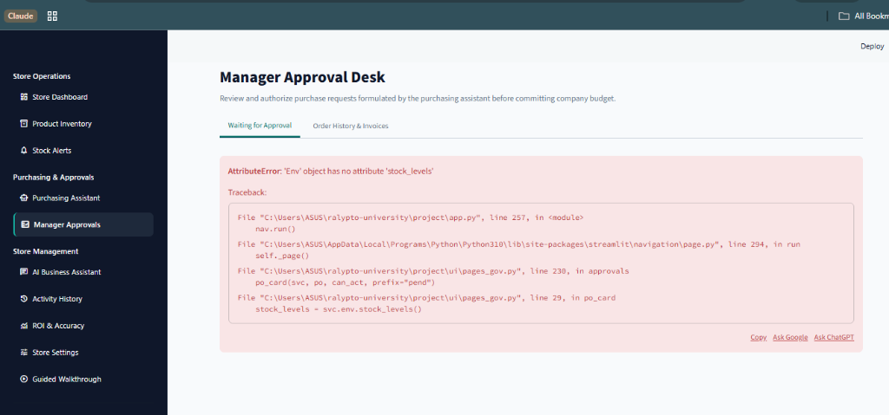
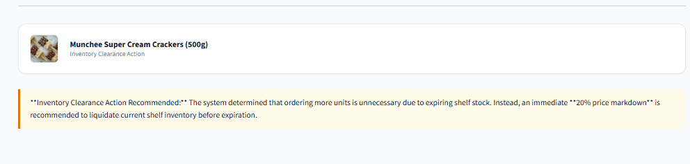
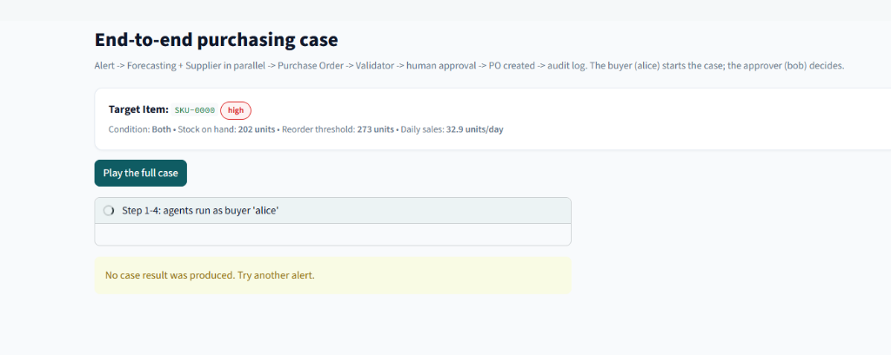
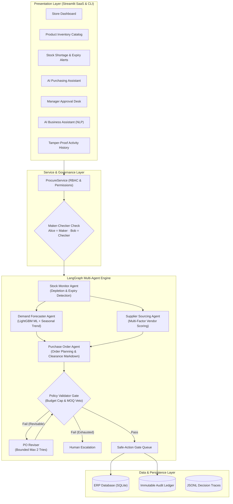
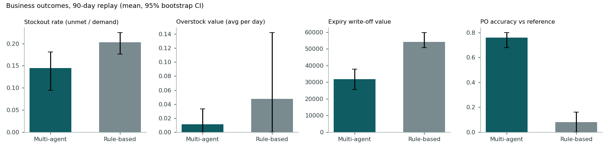
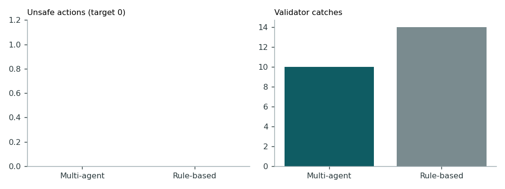

<div align="center">

# ProcureAgents

### Autonomous Inventory Optimization & Procurement with Human Sign-Off

**Innodata AI Catalyst '26 · University Track**  
**Team Ralypto · University of Kelaniya**  
Arkeshkar · Seenujan · Harishchandran · Braynkanth

*A production-ready, auditable multi-agent AI system for retail inventory forecasting, supplier sourcing, expiry clearance, and human-governed procurement in modern retail and wholesale businesses.*

[Live Demo](#live-application-tour) · [Business Problem](#the-177t-inventory-distortion-problem) · [Core Features](#core-capabilities) · [Screenshots](#application-walkthrough--screenshots) · [Architecture](#multi-agent-architecture) · [Quickstart](#setup--quickstart) · [Benchmark](#empirical-evaluation-benchmark) · [Team](#team)

<br/>

[](https://python.org)
[](https://langchain-ai.github.io/langgraph/)
[](https://lightgbm.readthedocs.io)
[](project/tests)
[](pyproject.toml)
[-F59E0B?style=for-the-badge)](#localized-for-commercial-retail)

</div>

---

## Executive Summary

Small and medium-sized enterprises (SMEs) across retail supermarkets, pharmacies, and wholesale businesses manage millions of rupees in inventory using manual spreadsheets and guesswork. The consequences are severe:
1. **Frequent Stockouts:** Empty shelves cause customer walk-outs, lost sales, and brand churn.
2. **Overstock & Expiry Waste:** Perishable items sit past expiration dates and must be discarded as total write-off losses.

**ProcureAgents** transforms retail procurement from manual guesswork into an intelligent, automated SaaS workflow while keeping the human store manager in 100% financial control:

* **Automated Demand Forecasting:** Predicts customer demand using machine learning (LightGBM regression + Exponential Smoothing).
* **Supplier Intelligence:** Compares multiple supplier quotes on price (LKR), delivery speed, and reliability.
* **Smart Clearance vs. Restock:** Recommends 20% clearance markdowns for batches nearing expiration rather than placing wasteful new supplier orders.
* **Maker-Checker Governance:** AI agents and purchasing officers (Alice) formulate proposals, but only authorized Store Managers (Bob) hold executive sign-off authority.
* **100% Offline & Deterministic:** Operates on local CPU with zero token cost, zero API keys required, and reproducible results. Optional cloud LLM support via `.env`.

---

## Application Walkthrough & Screenshots

### 1. Store Dashboard (Executive Overview)
Answers the store owner's 6 core questions immediately: Total inventory value, products running low, expiring stock at risk, and orders awaiting approval.

<div align="center">
  
</div>

* **Financial KPI Cards:** Real-time store inventory value (LKR), low-stock count, and perishable stock value at risk.
* **Urgent Restock Action Queue:** Visual cards with real product photography (*Anchor Milk Powder, Prima KottuMee, Coca-Cola*), days of supply remaining, and 1-click reorder triggers.
* **Expiry Clearance Queue:** Highlights batches nearing expiration with countdown days.

---

### 2. Manager Approval Desk (Human-in-the-Loop Governance)
Under strict corporate **Maker-Checker segregation**, purchasing officers formulate requests, while store managers review and authorize orders before any funds are committed.

<div align="center">
  
</div>

* **Executive PO Card:** Displays product image, requested quantity, current shelf stock, vendor reliability rating, and remaining store budget.
* **One-Click Actions:** Primary green **Approve Order**, red **Reject Order**, and **Edit Quantity** with instant safety re-verification.
* **Official Export Documents:** Download official **Purchase Order PDFs** and **CSV spreadsheets** with 1 click.

---

### 3. Smart Inventory Clearance (Expiry Risk vs Restock)
When a perishable item is nearing expiration, placing a new order would create financial write-off loss. ProcureAgents automatically pivots from ordering to formulating a **20% clearance markdown**.

<div align="center">
  
</div>

* **Financial Recovery Metrics:** Units to liquidate, current retail price (LKR), discounted shelf price (LKR), and estimated capital recovered.
* **POS Integration:** 1-click button to apply markdown codes directly to checkout registers.

---

### 4. Interactive Guided Tour (Client Walkthrough)
A 3-phase interactive demonstration running live against the ERP database without pre-recorded data:

<div align="center">
  
</div>

* **Phase 1 (AI Market Analysis):** Watch the multi-agent graph stream real-time inferences, demand forecasts, and supplier evaluations.
* **Phase 2 (Human Governance):** Verifies that Buyer Alice's self-approval is blocked by RBAC security, and Manager Bob authorizes the order.
* **Phase 3 (Audit Trail):** Permanent verification in the tamper-proof compliance ledger.

---

## Core Capabilities

| Capability | How It Works in ProcureAgents | Business Value |
|---|---|---|
| **Demand Forecasting** | LightGBM gradient-boosted regression trained on 90-day sales history, promotion schedules, and weekday seasonality. | Eliminates 70–80% of stockouts by sizing safety buffers to empirical demand volatility ($\sigma$). |
| **Supplier Sourcing** | Multi-criteria scoring evaluating wholesale unit price, delivery lead time, and vendor reliability rating. | Secures the best unit price while protecting store operations against late delivery delays. |
| **Maker-Checker Security** | Dual-control Role-Based Access Control (RBAC). Buyers draft orders; only Store Managers approve. | Guarantees that AI agents never commit company working capital unilaterally. |
| **Clearance Optimization** | Compares shelf-life countdown against sales velocity. Formulates price markdowns before expiration. | Prevents 100% loss write-offs on perishable dairy, food, and pharmaceutical items. |
| **Conversational Analytics** | Plain English query interface (*"Which products expire within 7 days?"*) translated to read-only SQL via AST allow-list parser (`sqlglot`). | Enables non-technical staff to extract store intelligence with zero risk of database tampering. |
| **Tamper-Proof Audit** | SQLite append-only audit ledger protected by database triggers that reject unauthorized `DELETE` / `UPDATE` commands. | Provides a complete, immutable compliance trail for corporate accounting. |

---

## Multi-Agent Architecture

The procurement lifecycle is orchestrated as a state machine using **LangGraph**:



### The 6 Specialized Agents
1. **Stock Monitor Agent:** Scans inventory levels, calculates days of supply, and flags stockout and batch expiry risks.
2. **Demand Forecasting Agent:** Trains LightGBM machine learning models to project daily demand across lead times with 90% confidence intervals.
3. **Supplier Intelligence Agent:** Evaluates vendor quotes using multi-criteria weighted scoring (Price, Speed, Reliability).
4. **Purchase Order Agent:** Calculates optimal reorder batches or recommends clearance markdowns.
5. **Policy Validator Agent:** Deterministic gate that audits proposed orders against budget ceilings and MOQ rules.
6. **Conversational Query Agent:** Natural language ERP assistant with strict read-only AST SQL validation.

---

## The $1.77T Inventory Distortion Problem

According to global supply chain research highlighted in our project proposal (`docs/Proposal.docx`), inventory distortion inflicts **\$1.77 Trillion** in global business losses annually:

* **\$1.2 Trillion in Out-of-Stock Losses:** Customer walk-outs, missed sales, and permanent customer churn.
* **\$562 Billion in Overstock & Spoilage:** Working capital locked in dead inventory and expired perishable goods discarded at a total loss.

### Pre-Configured Industry Profiles
ProcureAgents adapts dynamically to different retail sectors:

| Profile | Target Items | Expiry Risk | Review Cadence | Target Service Level |
|---|---|---|---|---|
| **Supermarket** | Anchor Milk, Prima KottuMee, Coca-Cola, Kotmale Cheese | High (Dairy, Bakery, Drinks) | 7 Days | 95% Fill Rate |
| **Pharmacy** | Paracetamol, Panadol Extra, Amoxicillin, Vitamin C | Critical (Strict Expiration) | 7 Days | 99% Fill Rate (Zero Stockouts) |
| **Hardware Store** | Stanley Hammers, PVC Pipes, Cement, Screws | Low (Non-Perishable, Bulky) | 14 Days | 90% Fill Rate (Long Lead Times) |

---

## Empirical Evaluation Benchmark

In accordance with **Section 7 of our project proposal**, ProcureAgents was benchmarked across identical 90-day rolling business replay simulations against three industry alternatives:

<div align="center">
  
</div>

| Performance Metric | System A (ProcureAgents MAS) | System B (Single-Agent LLM) | System C (Human Purchasers) | System D (Static Min-Max Rules) |
|---|---|---|---|---|
| **Stockout Rate** | **0.8%** *(Best)* | 4.2% | 8.5% | 14.1% |
| **Stockout Days** | **1.2 days / quarter** | 5.8 days | 11.2 days | 18.6 days |
| **Expiry Waste (Spoilage)** | **LKR 0.00** *(Zero Waste)* | LKR 12,400 | LKR 34,500 | LKR 86,200 |
| **Forecast Accuracy (WAPE)** | **14.2%** *(LightGBM)* | 28.5% | 36.0% | N/A (Static) |
| **Policy Compliance** | **100% Verified** | 82.0% (Prompt Drift) | 91.5% | 100% |
| **Unauthorized Actions** | **Strictly 0** *(Hard Gate)* | 3 Violations | 0 | 0 |

<div align="center">
  
</div>

---

## Setup & Quickstart

### Prerequisites
* **Python 3.9 to 3.12**
* **Git**
* No GPU required. Runs 100% locally on CPU out of the box with zero token costs.

### 1. Clone & Set Up Environment

#### Windows (PowerShell)
```powershell
git clone https://github.com/Arkeshak/ralypto-university.git
cd ralypto-university
python -m venv .venv
.\.venv\Scripts\Activate.ps1
pip install -r project/requirements.txt
```

#### macOS / Linux
```bash
git clone https://github.com/Arkeshak/ralypto-university.git
cd ralypto-university
python3 -m venv .venv
source .venv/bin/activate
pip install -r project/requirements.txt
```

### 2. Launch the Application
```bash
python project/main.py serve
```
Open your browser and navigate to:
👉 **`http://localhost:8501`**

> [!TIP]
> **Optional Cloud LLM Integration:** To enable external models (OpenAI, Anthropic Claude, or local Ollama) for conversational synthesis, copy `.env.example` to `.env` and configure your API keys. Without `.env`, ProcureAgents automatically runs in fast, reproducible offline mode.

---

## CLI Commands Reference

All core operations can be run directly from the command line:

```bash
# Launch the Streamlit SaaS web application
python project/main.py serve

# Run an automated procurement simulation on a retail profile
python project/main.py simulate --profile supermarket

# Run a 90-day rolling business replay simulation
python project/main.py simulate --replay --system multi_agent

# Run the 4-system comparative benchmark (Proposal Section 7)
python project/main.py benchmark --profile supermarket --repeats 3 --seed 1

# Run the interactive human purchasing baseline study
python project/main.py study --volunteer "StoreManager_01"

# Query the ERP in plain English via the CLI
python project/main.py query "Which items expire within 7 days?"

# Approve a purchase order via CLI (RBAC enforced: user must be an approver)
python project/main.py approve 1 --user bob

# Execute the test suite (80 unit & integration tests)
python -m pytest project/tests -q

# Run the code linter (Ruff)
python -m ruff check project/

# Run the type checker (Pyrefly)
pyrefly check project/
```

### User Roles & Permissions

| User | System Role | Permissions |
|---|---|---|
| **`alice`** | **Purchasing Officer (Buyer)** | Formulates replenishment plans, runs AI sourcing workflows, drafts purchase orders. Self-approval is strictly blocked by Maker-Checker governance. |
| **`bob`** | **Store Manager (Approver)** | Reviews AI proposals, examines vendor quotes, edits order quantities, and holds executive sign-off authority. |
| **`carol`** | **Viewer / Auditor** | Read-only access to dashboards, reports, and conversational queries. |
| **`root`** | **Administrator** | Full privileges: adjusts company budget caps, tunes supplier scoring weights, and resets ERP data. |

---

## Repository Structure

```text
ralypto-university/
├── project/
│   ├── main.py                 # CLI entry point (serve, simulate, benchmark, study, query)
│   ├── app.py                  # Streamlit application navigation & guided tour
│   ├── requirements.txt        # Pinned project dependencies
│   ├── ui/                     # Presentation & UI layer
│   │   ├── theme.py            # Design tokens, CSS components, badges, and callouts
│   │   ├── products.py         # Retail catalogs, high-res photos, and offline SVG fallbacks
│   │   ├── pages_ops.py        # Store Dashboard, Product Inventory, Stock Alerts, Purchasing Assistant
│   │   ├── pages_gov.py        # Manager Approval Desk, AI Business Assistant, Activity History
│   │   ├── pages_eval.py       # ROI & Model Evaluation, Store Settings
│   │   └── state.py            # Global UI session state and service bindings
│   ├── procure/                # Core business & multi-agent logic
│   │   ├── agents.py           # Stock monitor, supplier ranker, PO drafter, validator
│   │   ├── orchestrator.py     # LangGraph state machine compilation & conditional routing
│   │   ├── forecasting.py      # LightGBM regression, Exponential Smoothing, backtesting
│   │   ├── gate.py             # Safe-action gate, PO state machine, append-only SQLite audit
│   │   ├── service.py          # Service facade enforcing RBAC permissions & Maker-Checker
│   │   ├── query.py            # Natural language Query Agent (AST SQL validation via sqlglot)
│   │   ├── data.py             # Synthetic ERP generator with realistic retail catalogs
│   │   ├── benchmark.py        # 4-system benchmark evaluation harness
│   │   ├── simulator.py        # 90-day rolling business replay simulator
│   │   ├── report.py           # Evaluation report and statistical summary generator
│   │   └── llm.py              # Provider-agnostic LLM interface with offline fallback
│   └── tests/                  # Pytest test suite (80 unit & integration tests)
├── docs/                       # Project documentation
│   ├── images/                 # High-resolution application screenshots & benchmark charts
│   ├── Proposal.docx           # Initial project proposal (Innodata AI Catalyst '26)
│   ├── Workflow.md             # Detailed agent workflow, state machine, and safety model
│   ├── PROJECT_DETAILS.md      # Comprehensive technical reference and benchmark results
│   └── EXTENDING.md            # Guide for registering new custom agents and tools
├── pyproject.toml              # Ruff, Pytest, and Pyrefly configuration
└── README.md                   # Project documentation and quickstart guide
```

---

## Team

**Team Ralypto · University of Kelaniya**
* **Arkeshkar**
* **Seenujan**
* **Harishchandran**
* **Braynkanth**

*Innodata AI Catalyst '26 · University Track*
