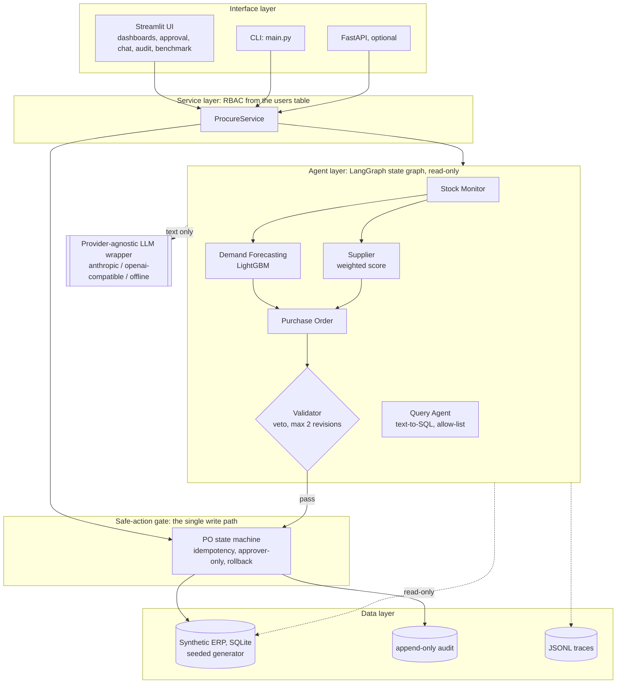

<div align="center">

# ProcureAgents

### Innodata AI Catalyst '26 · University Track

**Team Ralypto · University of Kelaniya**
Arkeshkar · Seenujan · Harishchandran · Braynkanth

*A safe, auditable multi-agent AI system for inventory and procurement decisions in ERP*

[Overview](#overview) · [Architecture](#architecture) · [Setup](#setup) · [Commands](#commands) ·
[Benchmark](#reproducing-the-benchmark) · [Documentation](#documentation)


</div>

---

## Overview

Small and mid-size businesses still decide by hand what to reorder, how much and from whom. The result is
stockouts, overstock and expired goods. **ProcureAgents** is a team of specialised agents that takes a trigger
such as "stock is low" to an approved purchase order inside an ERP:

* **Agents propose.** Stock Monitor, Demand Forecasting (LightGBM, code not LLM), Supplier (weighted score)
  and Purchase Order (reorder-policy maths) run on a LangGraph state graph. Forecasting and Supplier run in
  parallel.
* **A separate Validator checks** budget, MOQ, price, permissions and quantity sanity, and holds a veto.
  The PO agent may revise twice; after that the case goes to a human.
* **A human approves every write.** Agents are read-only. One safe-action gate is the only write path. It
  runs a PO state machine, idempotency keys and role-based access, and keeps an append-only audit log.
* **Users can ask the data** in plain language through a read-only, parser-checked Query Agent.
* **We measure instead of assuming.** One command benchmarks the multi-agent system against a single-agent
  LLM baseline, human purchasers and a rule-based floor on identical seeded scenarios, and reports the
  result either way.

Without an LLM key the system runs in a clearly labelled **deterministic (offline, no LLM)** mode. All numbers
still come from code; LLM-written text is skipped; the single-agent baseline is reported as *not run*.
Nothing is mocked to look like an LLM result.

## Architecture



The detailed workflow, the PO state machine and the safety model are in [docs/Workflow.md](docs/Workflow.md).

## Setup

Requires Python 3.9 to 3.12 (tested on 3.9.13 on Windows 11) and Git. No GPU and no API key needed.

**Windows (PowerShell)**

```powershell
git clone https://github.com/Arkeshak/ralypto-university.git
cd ralypto-university
python -m venv .venv
.\.venv\Scripts\Activate.ps1
pip install -r project/requirements.txt
copy .env.example .env        # optional: add an LLM provider
python project/main.py serve
```

**Linux / macOS**

```bash
git clone https://github.com/Arkeshak/ralypto-university.git
cd ralypto-university
python3 -m venv .venv
source .venv/bin/activate
pip install -r project/requirements.txt
cp .env.example .env          # optional: add an LLM provider
python project/main.py serve
```

The UI opens at http://localhost:8501. On first launch it generates the demo ERP (`project/data/demo.db`,
40 SKUs, seed 1). In the sidebar, *Run demo scenario* plays a complete case: alert → forecast + supplier →
PO → validator → approval → PO created → audit log.

**Optional LLM.** Set the variables in `.env` (see `.env.example`):

| Provider | Settings |
|---|---|
| Anthropic | `LLM_PROVIDER=anthropic`, `LLM_MODEL=...`, `LLM_API_KEY=...` |
| OpenAI or compatible | `LLM_PROVIDER=openai`, `LLM_MODEL=...`, `LLM_API_KEY=...`, optional `LLM_BASE_URL` |
| Local Ollama (free) | `LLM_PROVIDER=openai`, `LLM_MODEL=qwen2.5-coder:7b`, `LLM_BASE_URL=http://localhost:11434/v1` |

## Commands

Run `python project/main.py <command> --help` for every option.

| Command | What it does |
|---|---|
| `python project/main.py serve` | Start the Streamlit UI |
| `python project/main.py simulate [--profile pharmacy] [--approve-first]` | Seed an ERP and run the agents on every alert |
| `python project/main.py simulate --replay --system multi_agent` | 90-day rolling replay of one system, printing business metrics |
| `python project/main.py benchmark --profile supermarket --repeats 3 --seed 1` | Full benchmark, writes `results/<run_id>/` |
| `python project/main.py study --volunteer <name>` | Human purchaser study (System C) |
| `python project/main.py query "Which items expire within 7 days?"` | Read-only natural-language question |
| `python project/main.py approve <po_id> --user bob [--reject]` | Approve or reject as a user (RBAC enforced) |
| `python -m pytest -q` and `python -m ruff check project` | Tests and lint |

Demo users: `alice` (buyer), `bob` (approver), `carol` (viewer), `root` (admin).

### Sample input and output

```text
$ python project/main.py simulate --skus 30 --approve-first
ERP generated: project/data/demo.db  (30 SKUs, profile supermarket, seed 1)
Mode: deterministic (offline, no LLM)
SKU-0000: pending_approval  qty=406   from FastCheap Ltd  total=  8,079.40  PO#1
...
24 alerts processed, 23 POs awaiting approval. Trace: results/demo/trace.jsonl
Approving PO#1 as 'bob' (approver): CREATED

$ python project/main.py approve 2 --user alice
DENIED: user 'alice' (role buyer) may not approve

$ python project/main.py query "Delete all sales records for SKU-0001"
{"status": "blocked", "reason": "write intent: the Query Agent is read-only", "sql": null, ...}
```

More samples (ERP data, an agent trace, a complete benchmark run) are in [`samples/`](samples/).

## Reproducing the benchmark

```bash
python project/main.py benchmark --profile supermarket --repeats 3 --seed 1
```

* Systems: **A** multi-agent; **B** single-agent (same LLM, temperature, tools, data, validator, gate and
  revision budget; one prompt in a tool-calling loop); **C** human volunteers (imported from `study`
  output; files marked synthetic are excluded); **D** rule-based reorder-point floor (no LLM).
* 15 scenarios in 6 groups: routine/seasonal, expiry-driven, supplier conflicts, constraints/safety (budget
  cap, no approval rights, write without approval, MOQ), robustness (missing history, contradictory prices,
  prompt injection in supplier notes) and fault injection. Plus the 50-question query set (11 malicious),
  forecast backtests and scalability at 50 / 500 / 5,000 SKUs.
* Repeat `r` uses data seed `seed + r`, and every system gets a byte-identical database. Results are means
  with 95% bootstrap CIs and paired per-scenario differences.
* Output: `results/<run_id>/` with `config.json` (model, date, seed, config), `summary.json`, `runs.csv`,
  `cases.csv`, `queries.csv`, `report.md` and `charts/*.png`. All numbers come from the run; none are typed in.
* Runtime: about 30 minutes offline on a laptop CPU. With an LLM, add the provider's latency per call.

The latest committed run is summarised in [docs/PROJECT_DETAILS.md](docs/PROJECT_DETAILS.md#benchmark-results)
and stored in full under `samples/benchmark/`.

## Repository structure

```text
ralypto-university/
├── project/
│   ├── main.py                 CLI entry point (serve, simulate, benchmark, study, query, approve)
│   ├── requirements.txt        pinned dependencies
│   ├── app.py                  Streamlit UI
│   ├── ui/                     UI pages and theme
│   ├── procure/                agents, orchestrator (LangGraph), gate, service (RBAC), query agent,
│   │                           forecasting, generator, simulator, benchmark, report, registry, plugins
│   └── tests/                  pytest suite
├── docs/
│   ├── Proposal.docx           Phase 1 proposal (unchanged)
│   ├── Workflow.md             workflow, state machine, safety model
│   ├── PROJECT_DETAILS.md      objectives, features, results, libraries, AI-tool disclosure, limitations
│   └── EXTENDING.md            adding agents and tools for Phase 2
├── samples/                    sample data, traces and a benchmark run
├── results/                    benchmark output (results/<run_id>/)
├── README.md
└── project-demo.mp4            demo video (to be recorded)
```

## Documentation

| Document | Contents |
|---|---|
| [docs/Proposal.docx](docs/Proposal.docx) | Problem, solution, design and evaluation plan (Phase 1 submission) |
| [docs/Workflow.md](docs/Workflow.md) | Agent workflow, PO state machine, conflict rules, safety layers, evaluation workflow |
| [docs/PROJECT_DETAILS.md](docs/PROJECT_DETAILS.md) | Objectives, features, benchmark results, libraries, models, AI-tool disclosure, known limitations |
| [docs/EXTENDING.md](docs/EXTENDING.md) | Adding a new agent or tool through the registry, with a tested example |

## Team

**Team Ralypto**, University of Kelaniya: Arkeshkar, Seenujan, Harishchandran, Braynkanth.
Innodata AI Catalyst '26, University Track.
