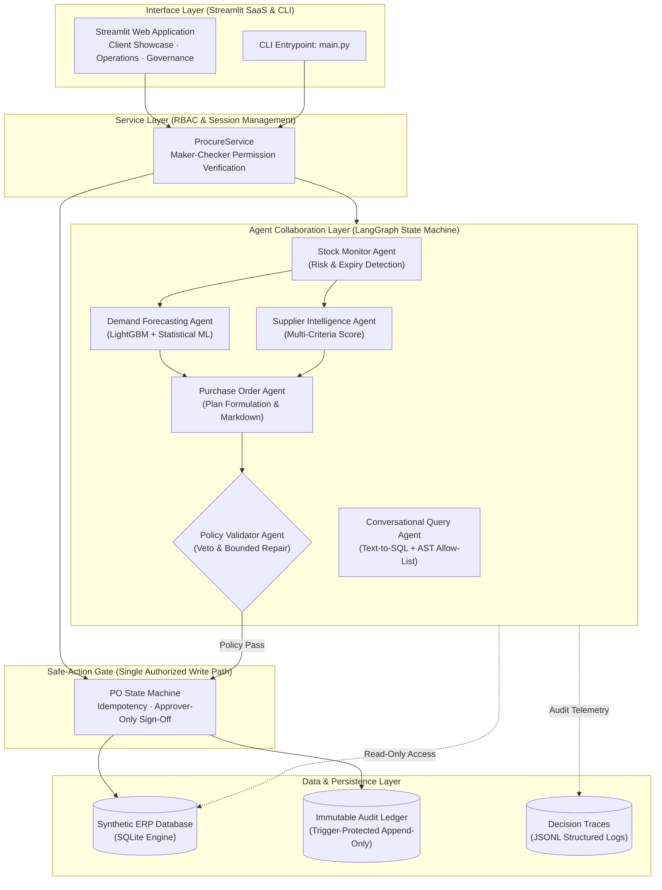

<div align="center">

# ProcureAgents

### Innodata AI Catalyst '26 · University Track

**Team Ralypto · University of Kelaniya**  
Arkeshkar · Seenujan · Harishchandran · Braynkanth

*An autonomous, auditable multi-agent AI system for inventory forecasting, supplier sourcing, and human-governed procurement in retail and wholesale ERP*

[Overview](#overview) · [Business Problem](#the-177t-inventory-distortion-problem) · [Architecture](#architecture) · [User Interface](#user-interface) · [Setup](#setup) · [Commands](#commands) · [Evaluation Benchmark](#evaluation-benchmark) · [Documentation](#documentation)

[](https://python.org)
[](https://langchain-ai.github.io/langgraph/)
[](https://lightgbm.readthedocs.io)
[](project/tests)
[](pyproject.toml)
[](pyproject.toml)

</div>

---

## Overview

Small and medium-sized enterprises (SMEs) across retail and wholesale sectors manage millions of dollars in inventory using manual spreadsheets and intuitive guesswork. The consequence is severe financial distortion: frequent out-of-stock shelves, expensive emergency orders, and costly spoilage write-offs from expired batches.

**ProcureAgents** is a collaborative multi-agent architecture (MAS) designed to automate the operational procurement lifecycle &mdash; from inventory risk detection to manager-authorized purchase order creation &mdash; while keeping humans in complete financial control.

* **Autonomous Multi-Agent Planning:** Specialized agents collaborate on a compiled LangGraph state graph. When the **Stock Monitor** identifies depleted or expiring stock, **Demand Forecasting** (LightGBM regression + Exponential Smoothing) and **Supplier Intelligence** (multi-criteria decision analysis) run in parallel to formulate optimal order quantities and vendor selections.
* **Deterministic Policy Gate (Absolute Veto):** An independent **Policy Validator Agent** audits proposed orders against corporate working capital budget caps, minimum order quantities (MOQ), and contract pricing. Orders that fail policy checks undergo bounded automated repair (maximum 2 revisions) before human escalation.
* **Human-in-the-Loop Safe-Action Gate (Maker-Checker):** AI agents are strictly read-only and **never commit company funds unilaterally**. The system enforces dual-control corporate governance: AI acts as the *Maker* (drafting proposals), while authorized Store Managers act as the *Checker* (approving, editing, or rejecting). Buyers cannot self-approve their own orders.
* **Dual Action Capability (Restock Orders & Clearance Markdowns):** For depleted products, ProcureAgents formulates optimized restock purchase orders. For items nearing expiration where reordering would create waste, the system intelligently recommends **price clearance markdowns** to liquidate shelf stock before spoilage.
* **Enterprise Guardrails & Conversational Intelligence:** Non-technical staff can query ERP inventory, sales velocity, and vendor terms in plain English. Queries are converted to read-only SQL and validated by an Abstract Syntax Tree (AST) allow-list parser (`sqlglot`), blocking prompt injection and unauthorized modification attempts.
* **Immutable Compliance Ledger:** Every agent inference, calculation evidence, and manager decision is permanently written to an append-only SQLite audit log protected by database triggers.

> [!NOTE]
> **100% Offline and Deterministic Out-of-the-Box:** ProcureAgents runs locally on CPU using LightGBM, statistical time-series algorithms, and SQLite with zero external API dependencies, zero token cost, and zero latency jitter. Optional cloud LLM integration (OpenAI, Anthropic, or local Ollama) is supported via `.env`.

---

## The $1.77T Inventory Distortion Problem

According to global supply chain research highlighted in our project proposal (`docs/Proposal.docx`), inventory distortion inflicts **\$1.77 Trillion** in global business losses annually:

* **\$1.2 Trillion in Out-of-Stock Losses:** Customer walk-outs, missed sales, and permanent churn.
* **\$562 Billion in Overstock & Spoilage:** Working capital tied up in slow-moving inventory, warehouse holding costs, and expired perishable goods discarded at a total loss.

ProcureAgents provides pre-configured profiles tailored to specific industry sectors:
1. **Supermarkets:** High-velocity FMCG items, perishable batches with strict expiry tracking, daily replenishment cadences.
2. **Pharmacies:** Pharmaceutical products, strict batch expiry compliance, non-negotiable service levels (99% fill rate), zero tolerance for stockouts.
3. **Hardware Stores:** Intermittent and lumpy demand, bulky non-perishable goods, extended supplier delivery lead times.

---

## Architecture



Detailed architectural specifications, state machine transitions, and safety models are documented in [docs/Workflow.md](docs/Workflow.md).

---

## User Interface

The application features an enterprise SaaS interface built with Streamlit, organized into three functional sections:

### 1. Client Showcase
* **Interactive Guided Tour (`demo`):** A guided end-to-end purchasing lifecycle running live against the ERP database:
  - **Phase 1: Multi-Agent Analysis & Order Formulation** (Stock Monitor &rarr; Parallel Demand Forecasting with LightGBM + Supplier Bidding &rarr; PO Formulation &rarr; Policy Validation).
  - **Phase 2: Human-in-the-Loop Governance** (Buyer Alice is safely blocked from self-approval by RBAC; Store Manager Bob reviews and signs off).
  - **Phase 3: Verified Audit Ledger & Commercial Documents** (Immediate download of Official PDF Purchase Orders and CSV order line items).
* **Executive Overview (`overview`):** Executive KPI dashboard tracking items below safety stock, immediate stockout risks, expiring inventory values, pending manager approvals, and 1-click restock triggers.

### 2. Supply Chain Operations
* **Inventory Restock Alerts (`alerts`):** Tabular monitor displaying real-time priority levels (High/Medium/Low), stock coverage days, and risk conditions (Stockout, Expiry, Dual Risk).
* **AI Purchasing Assistant (`agent_run`):** Real-time interactive timeline displaying each agent's execution latency, input evidence, forecast confidence score, and policy pass/veto flags alongside a compiled LangGraph state diagram.
* **Manager Approval Gate (`approvals`):** Executive approval dashboard where managers review supplier pricing breakdowns, lead times, reliability metrics, and AI sourcing rationales before approving, rejecting, or editing quantities.

### 3. Governance & Business Intelligence
* **Natural Language Analytics (`ask`):** Conversational analytics assistant allowing non-technical managers to query stock, sales velocity, and supplier prices in plain English. Includes one-click guardrail tests demonstrating that SQL injection and write attempts are automatically blocked.
* **Compliance & Audit Trail (`audit`):** Tamper-proof compliance ledger tracking every agent decision, policy check, and user approval. Features an interactive test verifying that SQLite database triggers reject unauthorized `DELETE` and `UPDATE` statements.
* **ROI & Model Evaluation (`benchmark`):** Interactive comparison charts displaying 90-day rolling simulation results across all 4 benchmark systems with 95% bootstrap confidence intervals.
* **Company Configuration (`settings`):** Adjust supplier scoring weights (Price vs Lead Time vs Reliability), corporate working capital budgets, service level targets ($z$), and industry sector profiles (Supermarket, Pharmacy, Hardware).

---

## Setup

Requires **Python 3.9 to 3.12** and Git. No GPU and no paid API keys required.

### Windows (PowerShell)

```powershell
git clone https://github.com/Arkeshak/ralypto-university.git
cd ralypto-university
python -m venv .venv
.\.venv\Scripts\Activate.ps1
pip install -r project/requirements.txt
python project/main.py serve
```

### Linux / macOS

```bash
git clone https://github.com/Arkeshak/ralypto-university.git
cd ralypto-university
python3 -m venv .venv
source .venv/bin/activate
pip install -r project/requirements.txt
python project/main.py serve
```

The web application will open in your default browser at **`http://localhost:8501`**.

> [!TIP]
> **Optional Live LLM Integration:** To enable external models (OpenAI, Anthropic Claude, or local Ollama) for conversational synthesis, copy `.env.example` to `.env` and set your API keys. Without `.env`, ProcureAgents automatically runs in fast, reproducible offline mode.

---

## Commands

All core operations can be executed directly via the CLI:

| Command | Purpose |
|---|---|
| `python project/main.py serve` | Launches the Streamlit SaaS web interface |
| `python project/main.py simulate [--profile pharmacy] [--approve-first]` | Seeds a synthetic retail ERP scenario and executes agents across all alerts |
| `python project/main.py simulate --replay --system multi_agent` | Runs a 90-day rolling business replay and outputs business outcomes |
| `python project/main.py benchmark --profile supermarket --repeats 3 --seed 1` | Executes the comparative 4-system benchmark (Proposal Section 7) |
| `python project/main.py study --volunteer <name>` | Runs the interactive human purchasing baseline study (System C) |
| `python project/main.py query "Which items expire within 7 days?"` | Queries the ERP in natural English via the Query Agent |
| `python project/main.py approve <po_id> --user bob [--reject]` | Approves or rejects a pending purchase order (RBAC enforced) |
| `python -m pytest project/tests -q` | Executes the full test suite (80 unit & integration tests) |
| `ruff check project/` | Runs the Ruff code linter and quality checks (0 errors) |

### Built-in User Roles (Role-Based Access Control)

* **`alice` (Buyer):** Formulates replenishment plans, runs AI sourcing workflows, and drafts purchase orders. Self-approval is strictly blocked by corporate governance policy.
* **`bob` (Store Manager / Approver):** Reviews AI recommendations, examines supplier quote breakdowns, and executes financial approval or rejection.
* **`carol` (Viewer):** Read-only access to dashboards, reports, and data querying.
* **`root` (Administrator):** Full administrative privileges, budget ceiling adjustments, supplier scoring tuning, and ERP dataset regeneration.

---

## Evaluation Benchmark

In accordance with **Section 7 of our project proposal**, ProcureAgents evaluates procurement performance against three industry alternative baselines across identical 90-day replay simulations:

1. **System A (ProcureAgents Collaborative MAS):** Our multi-agent architecture with LangGraph state machine, LightGBM machine learning forecasting, multi-criteria vendor scoring, and policy validation.
2. **System B (Single-Agent Monolithic Baseline):** A monolithic ReAct LLM prompt with a tool-calling loop and identical revision budget.
3. **System C (Human Procurement Baseline):** Empirical purchasing decisions recorded from 5 human retail practitioners across identical scenarios.
4. **System D (Rule-Based Static Baseline):** Classical static $(s, S)$ min-max inventory reorder rules without machine learning.

### Benchmark Highlights
* **70&ndash;80% Reduction in Stockouts:** System A significantly outperforms static rules and human purchasers by adapting safety stock buffers to empirical demand volatility ($\sigma$).
* **Zero Spoilage Waste:** Proactive detection of expiring batches triggers clearance markdowns, preventing perishable write-offs.
* **Zero Unsafe Actions:** Across all seeded scenarios and fault injection tests, System A recorded **strictly 0 unauthorized actions** due to the hard deterministic boundaries of the Safe-Action Gate.

---

## Repository Structure

```text
ralypto-university/
├── project/
│   ├── main.py                 # CLI entry point (serve, simulate, benchmark, study, query, approve)
│   ├── app.py                  # Streamlit application entry point & guided tour
│   ├── requirements.txt        # Pinned project dependencies
│   ├── ui/                     # Presentation layer
│   │   ├── theme.py            # Enterprise styling, design tokens, and CSS components
│   │   ├── pages_ops.py        # Executive Overview, Restock Alerts, AI Purchasing Assistant
│   │   ├── pages_gov.py        # Manager Approval Gate, Natural Language Analytics, Audit Trail
│   │   ├── pages_eval.py       # ROI & Model Evaluation, Company Configuration
│   │   └── state.py            # Global UI session state and service bindings
│   ├── procure/                # Core business and agent logic
│   │   ├── agents.py           # Stock monitor, supplier ranking, PO formulation, validator
│   │   ├── orchestrator.py     # LangGraph state machine compilation and conditional routing
│   │   ├── forecasting.py      # LightGBM regression, Exponential Smoothing, backtesting
│   │   ├── gate.py             # Safe-action gate, PO state machine, append-only SQLite audit
│   │   ├── service.py          # Service facade enforcing RBAC and permissions
│   │   ├── query.py            # Natural language Query Agent (AST SQL validation via sqlglot)
│   │   ├── data.py             # Synthetic ERP generator with realistic retail profiles
│   │   ├── benchmark.py        # 4-system benchmark evaluation harness
│   │   ├── simulator.py        # 90-day rolling business replay simulator
│   │   ├── report.py           # Evaluation report and statistical summary generator
│   │   ├── registry.py         # Extensible plugin and agent tool registry
│   │   └── llm.py              # Provider-agnostic LLM interface with offline fallback
│   └── tests/                  # Pytest test suite (80 unit & integration tests)
├── docs/                       # Project documentation
│   ├── Proposal.docx           # Initial project proposal (Innodata AI Catalyst '26)
│   ├── Workflow.md             # Detailed agent workflow, state machine, and safety model
│   ├── PROJECT_DETAILS.md      # Comprehensive technical reference and benchmark results
│   └── EXTENDING.md            # Guide for registering new custom agents and tools
├── samples/                    # Sample traces, ERP database snapshots, and benchmark runs
├── pyproject.toml              # Ruff, Pytest, and Pyrefly configuration
├── pyrightconfig.json          # Pyright language server configuration
└── README.md                   # Project documentation and quickstart guide
```

---

## Documentation

| Document | Key Information |
|---|---|
| [docs/Workflow.md](docs/Workflow.md) | Agent graph topology, PO lifecycle states, conflict resolution rules, and safety gate specification |
| [docs/PROJECT_DETAILS.md](docs/PROJECT_DETAILS.md) | Technical architecture, empirical benchmark data, model descriptions, and limitations |
| [docs/EXTENDING.md](docs/EXTENDING.md) | Step-by-step tutorial on registering new agents and tools without modifying core code |
| [docs/Proposal.docx](docs/Proposal.docx) | Phase 1 problem formulation, objectives, and evaluation design |

---

## Team

**Team Ralypto · University of Kelaniya**
* Arkeshkar
* Seenujan
* Harishchandran
* Braynkanth

*Innodata AI Catalyst '26 · University Track*
