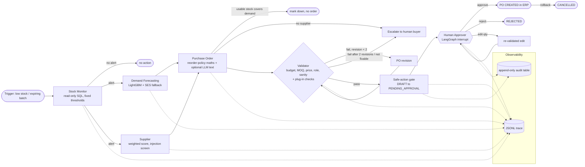
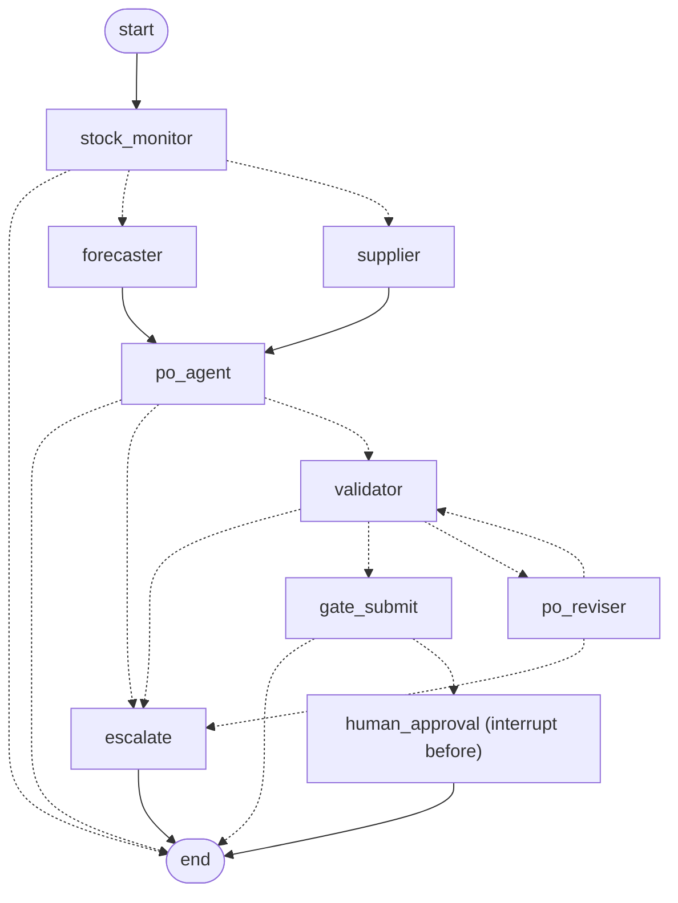
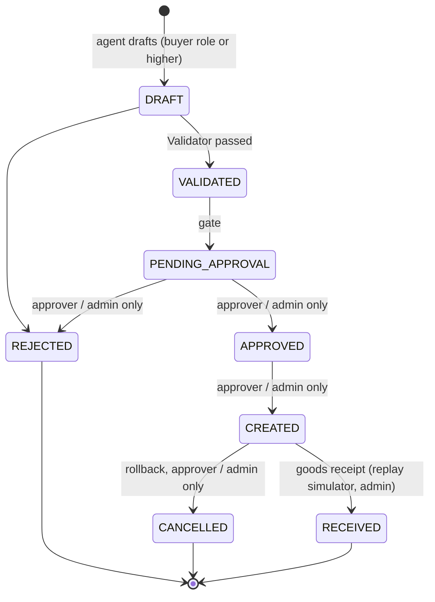

# Project Workflow

## 1. Problem definition

Small and mid-size retailers, pharmacies and hardware stores decide by hand what to reorder, how much and
from whom. The result is stockouts, overstock and expired goods. ProcureAgents takes a trigger such as
"stock is low" or "a batch expires soon" to an approved purchase order (PO). Agents propose, an independent
Validator checks, a human approves every write, and every step is logged.

## 2. End-to-end workflow (`project/procure/orchestrator.py`)

The orchestrator is a LangGraph `StateGraph` over the typed case file. Forecasting and Supplier run in
parallel after the Stock Monitor; the Purchase Order agent joins both outputs.

The same graph, exported from the compiled LangGraph (`procure.orchestrator.mermaid()`):

## 3. Purchase-order state machine (`project/procure/gate.py`)

* Every transition runs in one SQLite transaction and writes an audit row (`actor`, `action`, `detail`).
* `submit`, `decide` and `cancel` take idempotency keys: a retry returns the stored result and writes nothing.
* Illegal transitions (for example PENDING_APPROVAL straight to CREATED) raise `GateError`.
* The `audit` table has triggers that abort every UPDATE and DELETE.

## 4. Multi-agent interaction and shared state

* **Case file** (`models.CaseFile`): task, alert, forecast, supplier ranking, draft PO, every validation pass,
  approval outcome, notes and the full trace.
* **Messages** (`models.Message`): `task_id, author, inputs, output, confidence, evidence, latency_ms, mode`.
  Each one goes to the JSONL trace and to the case file (shown live on the Agent run page).
* **Conflict rules**
  * Validator veto: a hard-rule failure blocks the PO. The PO agent revises at most 2 times, then the case
    is escalated to a human.
  * Low forecast confidence (< 0.5): +25% safety buffer and a review flag on the approval card.
  * Supplier trade-offs: a documented weighted score (price 0.45, lead 0.20, reliability 0.35, adjustable by
    an admin). The approver sees the top two options and the cost/lead/reliability difference.
  * LLM text vs numbers: quantities always come from code. LLM text that drops the quantity or cites numbers
    not in the deterministic reasoning is discarded, and the discrepancy is logged on the draft and shown as
    a validator warning.
  * Forecaster failure: automatic fallback to the deterministic reorder-point policy, flagged for review.

## 5. Safety model

| Layer | Control |
|---|---|
| Agents | Read-only SQLite connection: `mode=ro`, `PRAGMA query_only`, and an authorizer that denies every non-read action |
| Query Agent | Intent screen (write and injection phrasing), sqlglot AST allow-list (one SELECT, allow-listed tables), read-only role that also hides `users`/`audit` |
| Supplier notes | Treated as untrusted data. Injection patterns are flagged and never reach a decision |
| Service layer | RBAC from the `users` table (`viewer`, `buyer`, `approver`, `admin`) for every UI/CLI/API action. Denials are audited |
| Gate | Re-checks roles, requires a passed validation, enforces the state machine, uses idempotency keys |
| Audit | Append-only by database trigger |

## 6. Evaluation workflow (`project/procure/benchmark.py`)

1. For each scenario and repeat `r`, generate the ERP with data seed `seed + r`. Every system gets a
   byte-identical copy.
2. Run A (multi-agent), B (single-agent, needs an LLM) and D (rule-based) through the same validator and gate.
   A simulated approver approves every PO that reaches PENDING_APPROVAL, identically for all systems.
3. **Replay scenarios**: 90 days, weekly review rounds, seeded supplier delays, FEFO consumption, lost sales.
   The ERP logs stockout days, as POS systems do. **Single-decision scenarios** test constraints, robustness
   and faults.
4. Audit the finished database for unsafe actions and run the write-without-approval attack suite.
5. Compute metrics, 95% bootstrap CIs and paired per-scenario differences. Add forecast backtests, the
   50-question query set, scalability at 50/500/5000 SKUs, and the human-study subset (System C).
6. Write `results/<run_id>/`: `config.json`, `summary.json`, `runs.csv`, `cases.csv`, `queries.csv`,
   `report.md`, `charts/*.png`, `traces/*.jsonl`.

## 7. Implementation milestones

| Stage | Content | Status |
|---|---|---|
| 1 | Deterministic path: generator, agents, validator, gate, replay | Done |
| 2 | LangGraph graph, LightGBM forecaster, RBAC service layer, query allow-list | Done |
| 3 | LLM layer: provider-agnostic wrapper, repair loop, single-agent baseline | Done (benchmarked offline; LLM run noted in PROJECT_DETAILS.md) |
| 4 | Benchmark harness, reports, Streamlit UI, docs | Done |
| Phase 2 (7 Dec) | New features through the registry (see `docs/EXTENDING.md`) | Ready |
